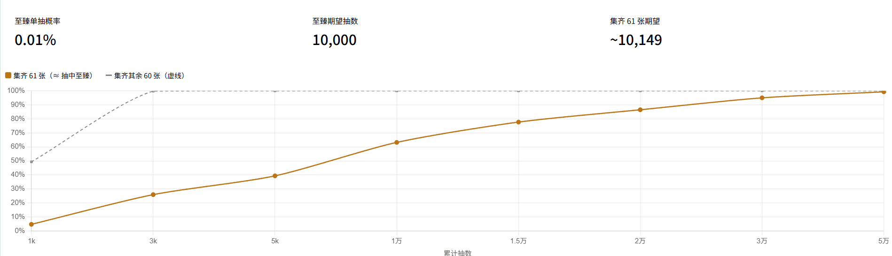

# 星尘 · 拟物抽卡

一个纯前端的拟物抽卡原型：61 张「新艺术运动·铜版版画」风格立绘，无限免费抽卡，GSAP 已本地化，无需后端。

- 线上卡图走 jsDelivr CDN 加速（国内访问更快），失败自动回退同源本地图片；本地开发直接用相对路径。无账号、无支付、无数据上传。

- **在线演示**：https://1parado.github.io/stardust-gacha/
- 设计文档：[策划案.md](策划案.md) · 技术选型：[工具与动效选型.md](工具与动效选型.md)

---

## 本地运行

```powershell
python -m http.server 5173 --bind 127.0.0.1
```

打开 http://localhost:5173 。必须走 HTTP（ES module 在 `file://` 下会被 CORS 拦截）。

---

## 玩法

三个 tab：**抽卡**（战绩、最新立绘、保底、单抽/五连/十连）、**图鉴**（61 张，已获得显示正面、未获得显示卡背）、**分享**（可切换「至臻时刻 / 图鉴进度」并保存 PNG）。

- 顶栏 ☀/☾ 切换暗色与浅色 iOS 玻璃风（参考 Apple Adopting Liquid Glass），偏好保存在本地。
- 移动端默认开启体感倾斜，图鉴卡与灯箱大卡随设备姿态做 3D 倾斜，小幅晃动即可看见。需要 HTTPS 或 localhost。
- 结果一落盘就刷新战绩，不等演出；连抽结果保证所有卡同屏可见。

---

## 抽卡规则

| 稀有度 | 概率 |
|---|---|
| N / R / SR / SSR | 59.99% / 30% / 9% / 1% |
| **EX 至臻** | **0.01%**（万分之一，全场唯一「无相」，不参与保底） |

- 软保底：第 63 抽起 SSR 概率每抽 +5.5%，第 80 抽必出 SSR+。
- 连抽保底：五连必出 R+，十连必出 SR+。
- 至臻独立判定，与保底互不影响。



单抽抽中至臻 0.01%（期望 1 万抽）；集齐 61 张的瓶颈几乎完全在至臻那一张——其余 60 张平均约 1,096 抽即可集齐，而完整集齐期望约 1.01 万抽，抽满 1 万次约 63% 概率达成。

---

## 代码结构

```
index.html / styles.css        外壳与全部样式
js/core.js                     纯逻辑：概率 / 保底 / 抽卡 / 存档（可在 Node 直接 import）
js/cards.js                    卡面渲染、立绘接入与预取、倾斜交互
js/gyro.js                     设备方向单例、校准与广播
js/reveal.js / lightbox.js     开卡演出 / 图鉴灯箱
js/ui.js                       交互接线
assets/cards/                  61 张 webp 立绘
tests/montecarlo.mjs           可复现的概率验证（带断言）
```

存档在 `localStorage`（`stardust.save.v3`），字段含累计抽数、按稀有度统计、已拥有卡、至臻记录。有脏数据校验与旧版迁移。立绘缺失时退回几何徽记，不会破图。

跑概率验证：`node tests/montecarlo.mjs 200000`。

---

## 说明

纯演示项目，无服务端、无经济系统。抽卡在客户端计算，正式上线应挪到服务端。立绘为 AI 生成，右下角带平台水印。

学AI，上[L站](https://linux.do/)
